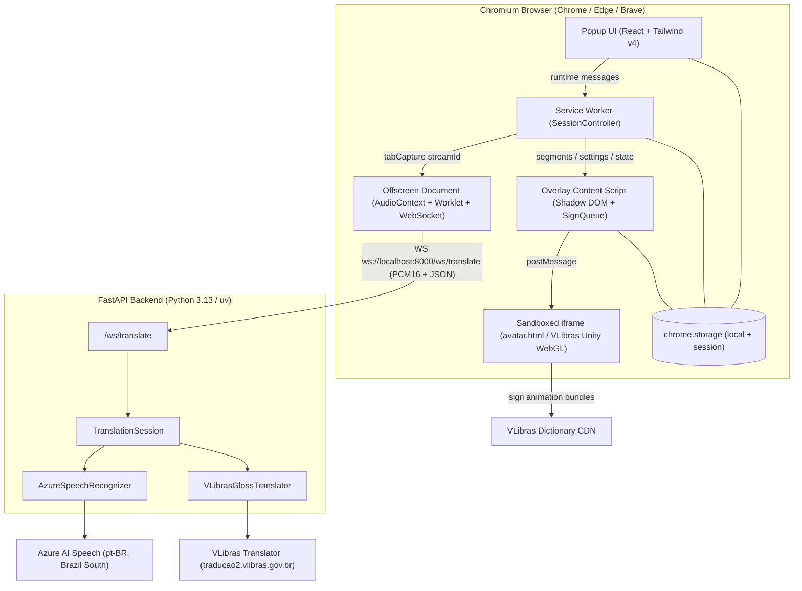

# VoxLibras

Real-time browser extension (Chromium, Manifest V3) and FastAPI streaming backend for
translating web video audio into Brazilian Sign Language (Libras) using a floating 3D avatar.

## Architecture



For deeper architectural details, state machine diagrams, latency budgets, and ADRs, see:
- [Architecture Overview](docs/architecture.md)
- [WebSocket Wire Protocol](docs/protocol.md)
- [ADR 0001 — Sandboxed VLibras Iframe](docs/adr/0001-vlibras-sandbox-iframe.md)
- [ADR 0002 — VLibras Gloss Translator vs LLM](docs/adr/0002-vlibras-gloss-translator.md)

## Repository Layout

```text
vox-libras/
├── .github/workflows/ci.yml   # Automated lint, typecheck, test and build checks
├── backend/                   # FastAPI WebSocket server (uv, Ruff, Pyright strict, pytest)
├── docs/                      # Architecture, WebSocket protocol and ADRs
└── extension/                 # Chromium MV3 extension (pnpm, WXT, React 19, TS strict, Tailwind v4)
```

## Prerequisites

- **Python** `>=3.13` and **[uv](https://docs.astral.sh/uv/)** (`>=0.12`)
- **Node.js** `>=22` (tested with `v24.13.0`) and **[pnpm](https://pnpm.io/)** (`>=10`)
- **Chromium-based browser**: Google Chrome, Microsoft Edge, or Brave
- **Azure AI Speech key** (recommended region: `brazilsouth`; the free `F0` tier provides 5 audio hours/month)

## Setup & Execution

### 1. Start the FastAPI Backend

```powershell
cd backend
uv sync
Copy-Item .env.example .env
# Edit .env and set AZURE_SPEECH_KEY=<your-azure-speech-key>
uv run uvicorn voxlibras.main:app --reload --port 8000
```

Verify the server is running:

```powershell
Invoke-RestMethod http://127.0.0.1:8000/health
# Expected: { "status": "ok", "sttConfigured": true }
```

### 2. Build & Load the Browser Extension

```powershell
cd extension
pnpm install
pnpm build
```

Load the compiled extension into Chrome, Edge, or Brave:
1. Open `chrome://extensions` (or `edge://extensions` / `brave://extensions`).
2. Enable **Developer mode**.
3. Click **Load unpacked** and select `extension/.output/chrome-mv3`.
4. Pin **VoxLibras** to the toolbar, open a video (e.g. YouTube), click **Começar** on onboarding, then click **Ativar Tradução**.

> During development you can also run `pnpm dev` inside `extension/` for hot-reload builds.

## Quality Checks & Tests

### Backend (`backend/`)

```powershell
cd backend
uv run ruff check .
uv run ruff format --check .
uv run pyright
uv run pytest
```

### Extension (`extension/`)

```powershell
cd extension
pnpm typecheck
pnpm lint
pnpm format:check
pnpm test
pnpm build
```

## Privacy & Accessibility Compliance

- **Volatile In-Memory Processing (LGPD):** Tab audio frames and recognized PT-BR transcripts exist
  only in RAM for the duration of a single session. Nothing is written to disk, databases,
  `chrome.storage`, or log files (logs record only segment UUIDs, byte counts, and latencies).
- **Libras Grammar (Gloss):** Recognized Portuguese sentences are converted to Libras gloss via
  VLibras prior to avatar signing, rather than literal word-by-word signed Portuguese.
- **Accessibility-Only Usage (LBI):** No transcript history, export, download, or copy feature
  is exposed; the overlay displays only the active segment's caption (`user-select: none`).

## Attribution & License

- The 3D WebGL player assets bundled in `extension/public/vlibras/` originate from
  [spbgovbr-vlibras/vlibras-player-webjs](https://github.com/spbgovbr-vlibras/vlibras-player-webjs)
  and are licensed under **LGPLv3** — see [extension/public/vlibras/LICENSE](extension/public/vlibras/LICENSE).

## Roadmap

- **Cloud Deployment:** Deploy the FastAPI translation service to cloud infrastructure (e.g., Azure
  Container Apps or App Service over `wss://`) with origin validation and authentication for remote
  usage beyond `localhost`.
- **Video Fullscreen Support:** Reparent the floating avatar overlay into native fullscreen video
  containers (`Element.prototype.moveBefore`).
- **Avatar Selection:** Add UI controls to switch between available VLibras 3D avatars.
- **Gloss Translation Evolution:** Evaluate and support domain-tuned LLM or transformer gloss
  translators behind the `GlossTranslator` Protocol (with zero-data-retention guarantees).
- **Cross-Device Preference Sync:** Add optional backend preference synchronization (e.g., SQLite
  or cloud storage) alongside local `chrome.storage.local`.
- **Browser & Store Distribution:** Package and publish the extension on the Chrome Web Store and
  evaluate cross-browser support beyond Chromium.
