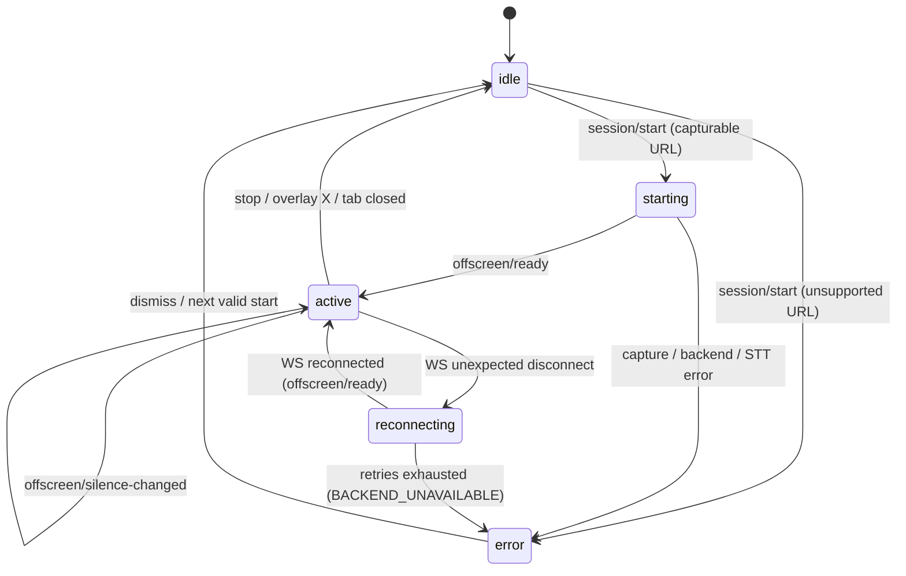

# VoxLibras Architecture

## 1. System Overview

VoxLibras splits real-time tab audio translation into two cooperating processes:

1. **Chromium MV3 Extension (`extension/`)**: Captures tab audio via `chrome.tabCapture`, keeps local playback audible, downsamples audio to 16 kHz mono PCM16 inside an `AudioWorklet`, streams frames over WebSocket, and renders the 3D Libras avatar inside a Shadow DOM overlay hosting a sandboxed iframe.
2. **FastAPI Backend (`backend/`)**: Keeps Azure Speech credentials off the client, bridges binary PCM audio into Azure AI Speech continuous recognition, translates final sentences into Libras gloss via VLibras, and emits ordered `segment` frames with per-stage latency metrics.

## 2. Session State Machine

The background service worker (`extension/src/entrypoints/background.ts`) owns the single active
session state via a pure reducer (`extension/src/lib/session/reducer.ts`) persisted in
`chrome.storage.session` (volatile memory, cleared on browser exit).

## 3. Real-Time Pipeline & Latency Budget

1. **Tab Audio Capture (`offscreen`)**: `AudioContext` runs at native system sample rate (typically 48 kHz) and connects `MediaStreamAudioSourceNode -> audioContext.destination` so users still hear the video.
2. **Worklet Resampling (`pcm-worklet.ts`)**: `AudioWorkletProcessor` mixes channels to mono, downsamples linearly to 16 kHz, quantizes to signed 16-bit PCM, and emits exact 100 ms frames (`1600` samples = `3200` bytes).
3. **Speech Recognition (`azure_speech.py`)**: `PushAudioInputStream` feeds Azure Speech (`pt-BR`, `brazilsouth`) with `Speech_SegmentationSilenceTimeoutMs = 400`. Final `recognized` events bridge from SDK threads to `asyncio.Queue` via `loop.call_soon_threadsafe`.
4. **Gloss Translation (`vlibras_gloss.py`)**: `TranslationSession` calls `GlossTranslator.translate(text)` sequentially with a `3.0s` timeout (`GLOSS_TIMEOUT_S`). On timeout or HTTP error, `gloss` is sent as `null` and the client falls back to `signableText()` (uppercased PT-BR text).
5. **Bounded Avatar Queue (`sign-queue.ts`)**: Because spoken Portuguese (~150 wpm) outpaces 3D signing at `1.0x`, `SignQueue` caps pending segments at `maxPending = 3` and drops the oldest pending segment on overflow so avatar lag remains bounded.

## 4. Privacy & Accessibility Architecture

- **Zero audio/transcript persistence (LGPD):** Neither the backend nor the extension writes audio buffers, transcripts, or glosses to files, databases, or `chrome.storage`.
- **Safe logging:** Backend logs include only UUID segment IDs, sample rates, latency metrics (`stt_ms`, `gloss_ms`), and fixed error codes.
- **Accessibility-only transcript display (LBI):** `OverlayWidget` renders only the currently signing sentence (`select-none`) and clears it as soon as the animation ends.

## 5. Roadmap & Planned Evolutions

- Deploy the FastAPI backend to cloud infrastructure (`wss://` on Azure Container Apps / App Service) with origin validation and authentication for remote usage beyond `localhost`.
- Benchmark or swap `VLibrasGlossTranslator` against a domain-tuned LLM/transformer via the `GlossTranslator` Protocol (with Azure Zero Data Retention / Modified Abuse Monitoring approval).
- Add stable partial-result streaming (`SpeechServiceResponse_StablePartialResultThreshold`) to cut perceived latency before sentence pauses.
- Support player fullscreen reparenting (`Element.prototype.moveBefore`), avatar selection, optional cross-device preference sync (e.g., SQLite or cloud storage), and Chrome Web Store distribution.
